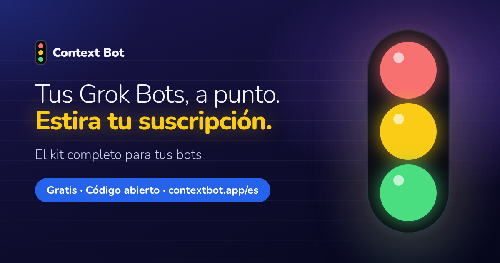
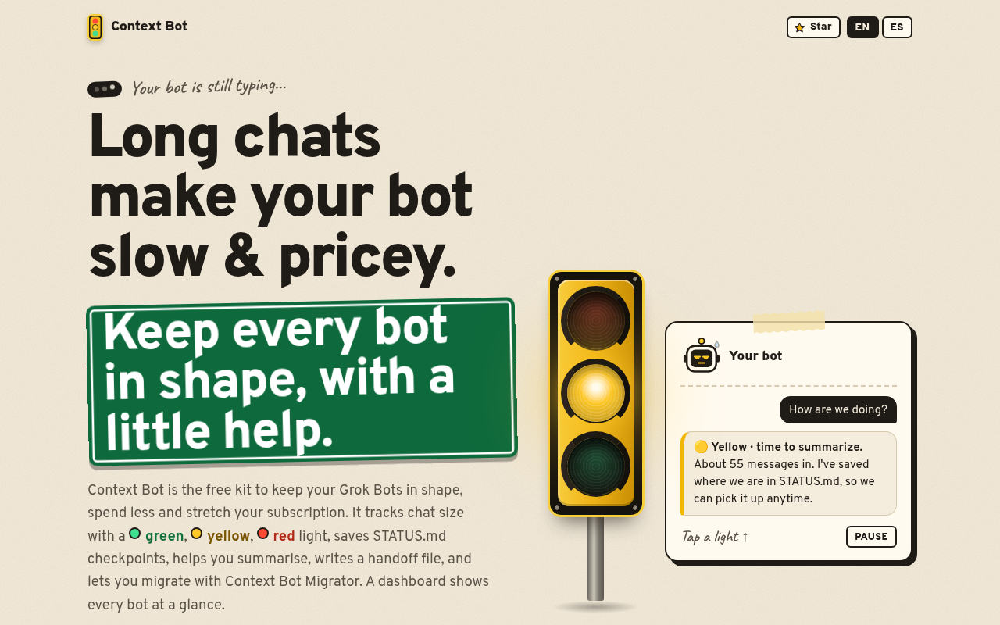
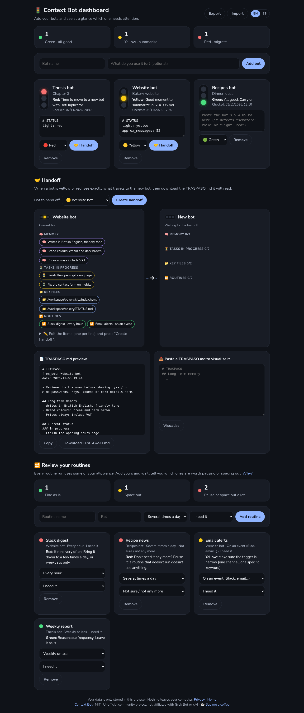

<div align="center">

<a href="https://contextbot.app/es/"></a>

# Context Bot

**Las charlas largas con Grok Bot se vuelven lentas y caras. Context Bot les pone un semáforo.**<br>
🟢 sigue · 🟡 toca resumir · 🔴 pasa a un bot nuevo, y un archivo de traspaso se lleva tu memoria.

[](https://github.com/AnaGuiDev/context-bot/stargazers)
[](LICENSE)
[](https://contextbot.app/es/)
[](docs/instalacion.md)
[](https://x.com/contextbotapp)
[](https://x.com/SoyAnaDev)
[](https://buymeacoffee.com/soyanadev)

**[⚡ Instálalo en un minuto](#-instálalo-en-un-minuto) · [🌐 Web](https://contextbot.app/es/) · [📊 Panel con ejemplos](https://contextbot.app/es/dashboard/?demo)** · [English](README.md)

**Tres bots amables, listos para añadir:** [🚦 Context Bot](https://x.ai/bot/-lByS9XGxzqHgCrOhrrJY) · [🧭 Migrator](https://x.ai/bot/oUJEAr2axANgtedIGrkNS) · [🪶 Lite](https://x.ai/bot/2O-oiBLKblZGBsfG0SVhG)

<a href="assets/video/promo-es-16x9.mp4"></a>

<sub>Pulsa la animación para ver el vídeo de un minuto con sonido.</sub>

Gratis, de código abierto, sin descargas ni registros. Si te ahorra una tarde lenta, **⭐ dale una estrella**: es la forma más fácil de que llegue a más gente.

</div>

---

## 🐢 El problema

Cuanto más larga es la conversación con tu bot, **más tarda en responder y más te cuesta**: en cada respuesta vuelve a leer todo lo anterior ([fuente](https://forum.cursor.com/t/grok-bot-context-window-size-and-token-accumulation-logic-in-pro/171540)). Casi nadie se da cuenta hasta que ya se arrastra, y entonces empezar de cero da miedo: un bot nuevo supone volver a explicarlo todo.

Context Bot te avisa a tiempo y te ayuda a seguir en un bot nuevo **sin empezar de cero**.

## 🚦 Cómo funciona

Tu bot estima cuánto se alarga la conversación, apunta en qué estáis en un `STATUS.md` y te lo resume con un color:

| | Color | Umbral aproximado | Qué pasa |
|---|---|---|---|
| 🟢 | **Verde** | Menos de ~40 mensajes | Todo bien. Sigue a lo tuyo. |
| 🟡 | **Amarillo** | 40–80 mensajes, o 1 resumen | Tu bot resume el trabajo en `STATUS.md` y sigue desde ahí. |
| 🔴 | **Rojo** | Más de 80 mensajes, o 2+ resúmenes | Tu bot escribe un archivo de traspaso y pasas a un bot nuevo. |

Los umbrales son estimaciones según la longitud de la charla, no un recuento exacto de tokens. Bastan para saber cuándo actuar.

## ⚡ Instálalo en un minuto

**[➕ Añadir Context Bot](https://x.ai/bot/-lByS9XGxzqHgCrOhrrJY)** · la plantilla se abre en Grok Bot. Añádela y tendrás un bot nuevo con la skill de Context Bot y sus instrucciones ya puestas.

1. **Añade Context Bot** desde la plantilla (enlace de arriba).
2. **Charla como siempre.** Según crece la charla, mira el semáforo por su cuenta y lleva un `STATUS.md` con en qué estáis. Pregunta *«¿En qué color estamos?»* cuando quieras, o pega su `STATUS.md` en el [panel](https://contextbot.app/es/dashboard/).
3. **En rojo, migra con Context Bot Migrator.** Tu bot escribe el archivo de traspaso ([ejemplo](examples/TRASPASO.md.example)) y te propone un bot nuevo. [Añade Context Bot Migrator](https://x.ai/bot/oUJEAr2axANgtedIGrkNS) y te acompaña en el cambio ([guía](docs/migrator.md); alternativa: [BotDuplicator](docs/integracion-botduplicator.md)); en la vista [Traspaso del panel](https://contextbot.app/es/dashboard/?demo#handoff) ves exactamente qué se lleva el bot nuevo.

**¿Ya tienes un bot? Pega este prompt** en su chat (GitHub te pone un botón para copiarlo a la derecha):

```text
Instala la skill de https://contextbot.app/es/skill.md en mi biblioteca de skills, guárdala exactamente como está escrita y confírmamelo.
```

Más detalle en [docs/instalacion.md](docs/instalacion.md).

## 🧭 Migrator (opcional)

Cuando el semáforo pasa a amarillo o rojo, la skill opcional **Context Bot Migrator** pasa el trabajo a un bot nuevo en cinco etapas comprobadas: inventario, un traspaso breve que revisas tú, bot nuevo solo tras tu sí, lista de verificación con las rutinas en pausa y vuelta atrás (el antiguo se oculta, nunca se borra). Mira [docs/migrator.md](docs/migrator.md).

**[➕ Añadir Context Bot Migrator](https://x.ai/bot/oUJEAr2axANgtedIGrkNS)** · la plantilla se abre en Grok Bot con la skill del Migrator lista.

## 🪶 Lite (opcional)

**Context Bot Lite** es la versión ligera: solo el semáforo y `STATUS.md`, con una revisión cada ~20 mensajes o cuando la pidas. Sin modo ahorro ni migración; en rojo sugiere Context Bot Migrator. [Añade la plantilla](https://x.ai/bot/2O-oiBLKblZGBsfG0SVhG); la skill está en [skills/context-bot-lite/](skills/context-bot-lite/). Más en [docs/lite.md](docs/lite.md).

¿No sabes de qué color está tu bot? Prueba el [chequeo de un minuto](https://contextbot.app/es/#check): un prompt, cualquier Grok Bot.

## 🧳 Antes y después

| Sin Context Bot | Con Context Bot |
|---|---|
| Te das cuenta de que va lento cuando ya se arrastra. | Un color te avisa a tiempo. |
| Sigues estirando una charla infinita. | Resumes en amarillo y cambias en rojo, cuando tú decides. |
| Un bot nuevo supone volver a explicar preferencias, decisiones y archivos. | Un archivo de traspaso lleva memoria, tareas y archivos clave. |
| Las rutinas se comen tu uso sin que lo veas. | El panel te señala qué rutinas conviene pausar o espaciar. |

Context Bot no hace más listo a tu bot. Te avisa de cuándo actuar.

## 📦 Qué incluye

- **Skill** para tu bot, en [español](skills/context-bot/SKILL.md) y en [inglés](skills/context-bot/en/SKILL.md) (en <https://contextbot.app/es/skill.md> y <https://contextbot.app/skill.md>): cuándo comprobar, cómo estimar, cuándo avisar y cómo hacer el traspaso.
- **Skill de bienvenida opcional** [`getting-started-context-bot`](skills/getting-started-context-bot/SKILL.md): guía la primera conversación de un nuevo Context Bot con su dueño.
- **[Panel](https://contextbot.app/es/dashboard/)** con semáforo: sin servidor ni cuenta, guarda en tu navegador.
- **Vista Traspaso** en el panel: elige un bot en amarillo o rojo y mira cómo pasan al bot nuevo su memoria, tareas, archivos y rutinas. Luego copia o descarga el `TRASPASO.md`, o pega uno para revisarlo.
- **Revisión de rutinas** en el panel: te marca las que conviene pausar o espaciar.
- **[Prompts](prompts/bot-coordinador.md)**, incluido un bot coordinador que vigila a los demás.
- **[Ejemplo de STATUS.md](examples/STATUS.md.example)** y **[ejemplo de TRASPASO.md](examples/TRASPASO.md.example)**.
- **[Trucos para gastar menos](docs/tips-ahorro.md)**, cada uno con su fuente.
- **Web bilingüe** (español e inglés) generada desde `src/` con `bash scripts/build-site.sh` → `dist/`. Sin frameworks, sin rastreadores, con la fuente alojada en la propia web.

## 🖥️ La página y el panel

<div align="center">

</div>

<div align="center">

</div>

Apunta tus bots, pega su estado y mira de un vistazo cuál necesita atención. Detecta solo líneas como `semaforo: rojo`. Puedes exportar e importar todo en JSON. Nada sale de tu ordenador.

## 💡 Trucos para gastar menos

No respondas «ok» a cada mensaje, junta tus peticiones, pausa las rutinas que no uses y espacia las demás. Todos los trucos, con sus fuentes, en [docs/tips-ahorro.md](docs/tips-ahorro.md). Los que aún no hemos podido confirmar están en [docs/tips-pendientes.md](docs/tips-pendientes.md).

## ❓ Preguntas frecuentes

<details><summary><b>¿Es gratis?</b></summary>

Sí. Gratis y de código abierto, con licencia MIT. Sin versión de pago.
</details>

<details><summary><b>¿Tengo que saber programar?</b></summary>

No. Añades Context Bot desde la plantilla y charlas como siempre. ¿Ya tienes un bot? Pegas un prompt en su chat y listo.
</details>

<details><summary><b>¿Plantilla o prompt?</b></summary>

La plantilla crea un bot nuevo con la skill de Context Bot y sus instrucciones listas. El prompt añade la misma skill a un bot que ya tienes, así que conserva su charla, su memoria y su configuración. El semáforo funciona igual en los dos casos.
</details>

<details><summary><b>¿Pierdo mi trabajo al pasar a un bot nuevo?</b></summary>

Al duplicar un bot no se copia su memoria aprendida, así que antes de cambiar, tu bot escribe un archivo de traspaso (`TRASPASO.md`) con tus preferencias, decisiones, tareas y archivos clave. El bot nuevo lo lee y lo guarda en su memoria. Revisa el archivo antes de cambiar: nunca debe llevar contraseñas ni claves. El bot antiguo sigue ahí para consulta: ocúltalo, no lo borres.
</details>

<details><summary><b>¿Lee o sube mis conversaciones?</b></summary>

No. La skill funciona dentro de tu propio bot, y la web y el panel lo guardan todo en tu navegador (`localStorage`). El conector opcional de estado en directo (código en [`worker/`](worker/), aún sin desplegar) solo envía el nombre del bot, su color y unas pocas estimaciones, nunca tu conversación.
</details>

<details><summary><b>¿Es exacta la estimación?</b></summary>

No. Es una estimación aproximada según la longitud de la charla. Sirve para avisarte de cuándo actuar, mucho antes de que lo notes lento.
</details>

<details><summary><b>¿Es oficial de Grok Bot?</b></summary>

No. Es un proyecto comunitario no oficial, sin relación con Grok Bot ni con xAI. BotDuplicator es una herramienta de terceros, tampoco relacionada.
</details>

## 🗺️ Hoja de ruta

No hay fechas: depende del tiempo libre y de lo que pidáis.

- [x] Web y panel en inglés y en español.
- [x] Pegar un `TRASPASO.md` en el panel para ver qué se lleva el bot nuevo.
- [x] Versión en inglés de la skill.
- [x] Kit de plantilla del bot listo para publicar ([templates/context-bot-template.md](templates/context-bot-template.md)).
- [x] Conector opcional de estado en directo (MCP): código y pruebas en [`worker/`](worker/), ver [docs/conector.md](docs/conector.md). Aún sin desplegar.
- [x] Enlace público de la plantilla del bot.
- [ ] Que el panel funcione sin conexión (instalable como app).
- [ ] Probar el traspaso de memoria en más casos reales y mejorar la plantilla.
- [ ] Más trucos para gastar menos, siempre con fuente.

¿Echas algo en falta? [Propón una idea](https://github.com/AnaGuiDev/context-bot/issues/new?template=idea.yml).

## 🤝 Contribuir

Las ideas, correcciones y traducciones son bienvenidas. Lee [CONTRIBUTING.md](CONTRIBUTING.md), abre un [issue](https://github.com/AnaGuiDev/context-bot/issues) y respeta el [Código de conducta](CODE_OF_CONDUCT.md). Los textos de la web están en [`src/i18n.py`](src/i18n.py).

## ☕ Apoya el proyecto

Context Bot es y seguirá siendo gratis. Sin anuncios, sin rastreadores, sin versión de pago.

<div align="center">

[](https://github.com/AnaGuiDev/context-bot)
[](https://buymeacoffee.com/soyanadev)
[](https://x.com/SoyAnaDev)

</div>

- **⭐ Dale una estrella al repositorio:** ayuda a que otros lo encuentren.
- **☕ Buy Me a Coffee:** [buymeacoffee.com/soyanadev](https://buymeacoffee.com/soyanadev).
- **💸 Propinas en X:** botón de Propinas en el perfil de [@SoyAnaDev](https://x.com/SoyAnaDev).
- **Sigue a [@contextbotapp](https://x.com/contextbotapp)** para enterarte de las novedades, y compártelo con quien tenga un bot que sigue escribiendo.

## 🔒 Privacidad

La web no usa cookies ni seguimiento, y la fuente y el vídeo se sirven desde la propia web. El panel guarda tus datos solo en tu navegador. Más detalle en la [página de privacidad](https://contextbot.app/es/privacidad.html). Para avisar de un fallo de seguridad, lee [SECURITY.md](SECURITY.md).

## 💛 Créditos

Hecho con cariño por **Ana Gui** ([@SoyAnaDev](https://x.com/SoyAnaDev)). Gracias a quienes prueban, opinan y mejoran el kit.

Insignias: [shields.io](https://shields.io). Fuente [Nunito](https://github.com/googlefonts/nunito) (licencia SIL OFL 1.1). Código de conducta basado en el [Contributor Covenant](https://www.contributor-covenant.org/).

## 📄 Licencia

[MIT](LICENSE) © 2026 Ana Gui

> Proyecto comunitario no oficial. No está afiliado a Grok Bot ni a xAI.
