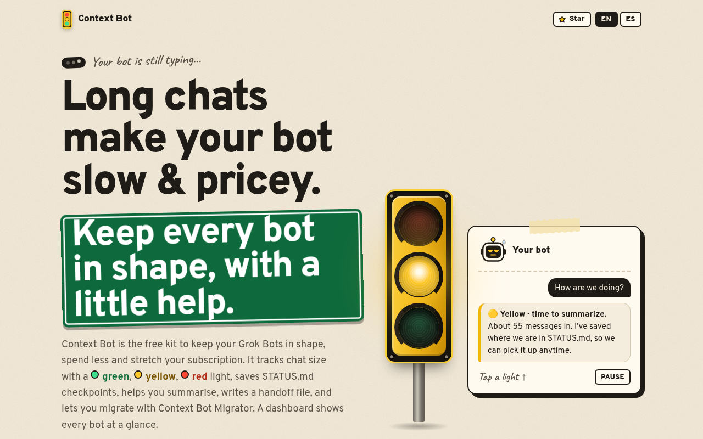
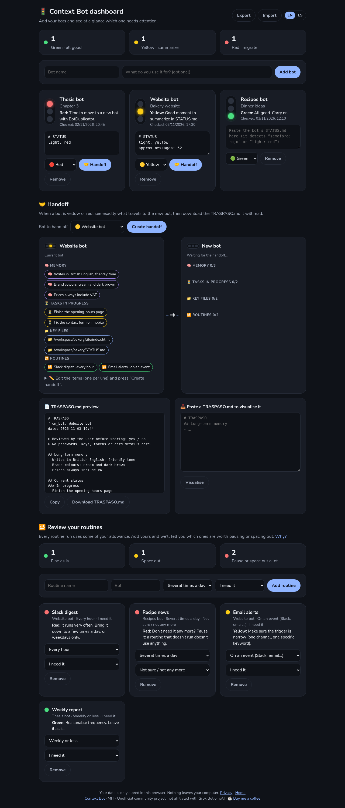

<!-- TODO(PLACEHOLDER): repository URL, X profile and donation link. See PLACEHOLDERS.md -->

# 🚦 Context Bot

**Keep your bot fast.**

A free, open-source kit that stops your long Grok Bot conversations from getting slow and expensive.

**[🌐 Website](https://contextbot.app/) · [📊 Try the dashboard with sample data](https://contextbot.app/dashboard/?demo)** · [Español](README.es.md)

[Get started](#-get-started-in-3-steps) · [Moving to a new bot](docs/en/botduplicator-integration.md) · [FAQ](#-faq) · [☕ Buy me a coffee](https://buymeacoffee.com/soyanadev)

Click the animation to watch the full video with sound.

**[➕ Install Context Bot](#install)** (one prompt) · ⭐ **Star the repo** if it helps · **[Follow @SoyAnaDev](https://x.com/SoyAnaDev)** for updates

---

## 🤔 The problem

The longer your conversation with a bot gets, **the slower it replies and the more it costs**, because it rereads everything that came before on every reply. Most people only notice once it's already sluggish, and by then starting over feels risky because you might lose your work.

Context Bot warns you in time and helps you carry on **without losing anything**.

## 🚦 How it works

Your bot estimates how big the conversation is, keeps a `STATUS.md` file with where things stand, and sums it up as a colour:

| | Colour | What it means | What to do |
|---|---|---|---|
| 🟢 | **Green** | All good | Carry on |
| 🟡 | **Yellow** | The chat is getting heavy | Summarise in `STATUS.md` and work from there |
| 🔴 | **Red** | Slow and expensive | Write the handoff and move to a new bot |

## 📦 What's inside

- **[Skill](skills/context-bot/SKILL.md)** for your bot: when to check, how to estimate, when to warn you and how to move on. (The skill text is in Spanish for now; your bot will still reply in your language.)
- **[Dashboard](https://contextbot.app/dashboard/)** with a traffic light: no server, no account, data stays in your browser.
- **Handoff view** in the dashboard: pick a yellow or red bot and watch its memory, tasks, key files and routines move across to the new bot. Then copy or download the `TRASPASO.md` handoff file.
- **Routine review** in the dashboard: flags the routines worth pausing or slowing down.
- **[Prompts](prompts/bot-coordinador.md)**, including a coordinator bot that keeps an eye on the others.
- **[Sample STATUS.md](examples/STATUS.md.example)** and **[sample TRASPASO.md](examples/TRASPASO.md.example)**.
- **[Guide to moving to a new bot](docs/en/botduplicator-integration.md)** with BotDuplicator.
- **[Tips for using less](docs/en/tips.md)**, each with its source.
- **Bilingual website ready to publish** (`scripts/build-site.sh` → `dist/`), with a guide in [docs/publicar.md](docs/publicar.md).

## 🚀 Get started in 3 steps

1. **Add the bot, or just the skill.**
   - **New bot:** a ready-made template is coming soon. For now, create a bot and paste the prompt below. <!-- TODO(PLACEHOLDER): enlace de plantilla pendiente (ver PLACEHOLDERS.md) -->
   - **Your own bot:** paste this into its chat:
     > Install the skill at https://contextbot.app/skill.md into my skill library, save it exactly as written, then confirm.
2. **Check the light.** Ask *"What color are we on?"* or paste its `STATUS.md` into the [dashboard](https://contextbot.app/dashboard/).
3. **Switch bots when it's time.** On red, follow the [BotDuplicator guide](docs/en/botduplicator-integration.md). The memory travels in a handoff file ([example](examples/TRASPASO.md.example)), and the dashboard's [Handoff view](https://contextbot.app/dashboard/?demo#handoff) shows you exactly what the new bot takes with it.

More detail in [docs/en/installation.md](docs/en/installation.md).

## 🖥️ The website and the dashboard

Add your bots, paste their status and see at a glance which one needs attention. It picks up lines like `light: red` on its own. **Handoff** shows what travels to the new bot and gives you the `TRASPASO.md`. You can also paste one in to check it. **Review your routines** suggests which ones to pause or run less often. You can export and import everything as JSON. Nothing leaves your computer.

## 💡 Tips for using less

Don't reply "ok" to every message, batch your requests, pause routines you don't use and space out the rest. All the tips, with sources, are in [docs/en/tips.md](docs/en/tips.md).

## ❓ FAQ

<b>Is it free?</b>

Yes. Free and open source, under the MIT licence.

<b>Do I need to know how to code?</b>

No. You copy, paste and talk to your bot as usual.

<b>Do I lose my conversation when I move?</b>

No. Duplicating a bot doesn't copy its learned memory, so the bot writes a handoff file (`TRASPASO.md`) with your preferences, decisions and progress. The new bot reads it and saves it to memory. The old bot is still there if you need it: hide it rather than deleting it.

<b>Is the size estimate exact?</b>

No, it's a rough estimate based on how long the chat is. It's good enough to know when to act.

<b>Where is the dashboard data stored?</b>

Only in your browser (`localStorage`). There's no server.

<b>Is this an official Grok Bot project?</b>

No. It's a community project with no official link to Grok Bot or xAI.

## 🗺️ Roadmap

Ideas for future versions. No dates: they depend on spare time and on what you ask for.

- [x] Website and dashboard in English and Spanish.
- [x] Paste a `TRASPASO.md` into the dashboard to see what the new bot takes with it.
- [x] English version of the skill ([`skills/context-bot/en/SKILL.md`](skills/context-bot/en/SKILL.md), served at <https://contextbot.app/skill.md>).
- [x] Ready-to-publish bot template ([templates/context-bot-template.md](templates/context-bot-template.md)).
- [x] Optional live status in the dashboard through an MCP connector: code and tests in [`worker/`](worker/), see [docs/en/connector.md](docs/en/connector.md). Not deployed yet.
- [ ] Make the dashboard work offline (installable as an app).
- [ ] Test memory handoff in more real cases and improve the template.

Missing something? [Suggest an idea](https://github.com/AnaGuiDev/context-bot/issues/new?template=idea.yml).

## 🤝 Contributing

Ideas, fixes and improvements are welcome. Read [CONTRIBUTING.md](CONTRIBUTING.md), open an [issue](https://github.com/AnaGuiDev/context-bot/issues) and follow the [Code of Conduct](CODE_OF_CONDUCT.md).

## ☕ Support the project

Context Bot is free and will stay that way. If it's saved you some time, you can:

- **☕ Buy Me a Coffee:** [buy me a coffee](https://buymeacoffee.com/soyanadev).
- **💸 Tips on X:** use the Tips button on my [X profile](https://x.com/SoyAnaDev).
- **Follow me on X** for updates: [@SoyAnaDev](https://x.com/SoyAnaDev).

**⭐ [Star the repo](https://github.com/AnaGuiDev/context-bot)** and **[follow @SoyAnaDev on X](https://x.com/SoyAnaDev)**: it's the easiest way to help, and you'll hear about new versions first. Sharing it with someone who'd find it useful helps a lot too.

## 🔒 Privacy

The website uses no cookies or tracking, and the font and video are served from the site itself. The dashboard keeps your data in your browser only (`localStorage`). More on the [privacy page](https://contextbot.app/privacy.html). To report a security issue, read [SECURITY.md](SECURITY.md).

## 💛 Credits

Made with care by **Ana Gui**. Thanks to everyone who tries the kit, shares feedback and improves it.

Badges: [shields.io](https://shields.io). Font: [Nunito](https://github.com/googlefonts/nunito) (SIL OFL 1.1). Code of Conduct based on the [Contributor Covenant](https://www.contributor-covenant.org/).

## 📄 Licence

[MIT](LICENSE) © 2026 Ana Gui

> Unofficial community project. Not affiliated with Grok Bot or xAI.
