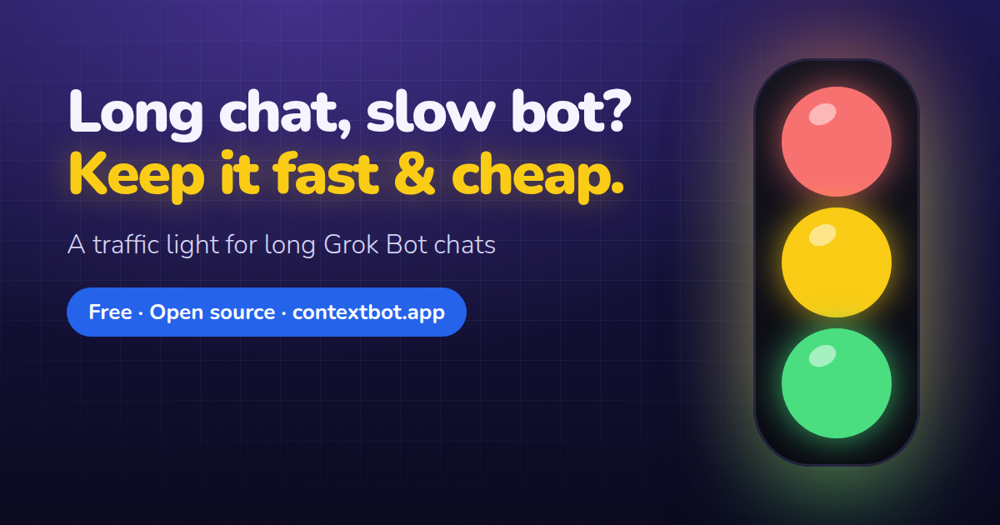

<div align="center">

<a href="https://contextbot.app/"></a>

# Context Bot

**Long Grok Bot chats get slow and expensive. Context Bot gives them a traffic light.**<br>
🟢 carry on · 🟡 time to summarize · 🔴 move to a fresh bot, and a handoff file brings your memory along.

[](https://github.com/AnaGuiDev/context-bot/stargazers)
[](LICENSE)
[](https://contextbot.app/)
[](docs/en/installation.md)
[](https://x.com/contextbotapp)
[](https://x.com/SoyAnaDev)
[](https://buymeacoffee.com/soyanadev)

**[⚡ Install in about a minute](#-install-in-about-a-minute) · [🌐 Website](https://contextbot.app/) · [📊 Dashboard demo](https://contextbot.app/dashboard/?demo)** · [Español](README.es.md)

**Three friendly bots, ready to add:** [🚦 Context Bot](https://x.ai/bot/-lByS9XGxzqHgCrOhrrJY) · [🧭 Migrator](https://x.ai/bot/oUJEAr2axANgtedIGrkNS) · [🪶 Lite](https://x.ai/bot/2O-oiBLKblZGBsfG0SVhG)

<a href="assets/video/promo-en-16x9.mp4"></a>

<sub>Click the animation to watch the one-minute video with sound.</sub>

Free, open source, no download, no sign-up. If it saves you a slow afternoon, **⭐ star the repo**: it's the easiest way to help other people find it.

</div>

---

## 🐢 The problem

The longer your chat with a bot gets, **the slower it replies and the more it costs**, because every reply rereads everything that came before ([source](https://forum.cursor.com/t/grok-bot-context-window-size-and-token-accumulation-logic-in-pro/171540)). Most people only notice once it's already crawling, and by then starting over feels risky: a fresh bot means re-explaining everything.

Context Bot warns you in time and helps you carry on in a fresh bot **without starting from zero**.

## 🚦 How it works

Your bot estimates how long the conversation is getting, keeps a `STATUS.md` with where things stand, and sums it up as a color:

| | Color | Rough threshold | What happens |
|---|---|---|---|
| 🟢 | **Green** | Under ~40 messages | All good. Carry on. |
| 🟡 | **Yellow** | 40–80 messages, or 1 summary | Your bot summarizes the work in `STATUS.md` and carries on from there. |
| 🔴 | **Red** | 80+ messages, or 2+ summaries | Your bot writes a handoff file and you move to a fresh bot. |

Thresholds are rough estimates based on chat length, not exact token counts. Good enough to know when to act.

## ⚡ Install in about a minute

**[➕ Add Context Bot](https://x.ai/bot/-lByS9XGxzqHgCrOhrrJY)** · the template opens in Grok Bot. Add it and you get a new bot with the Context Bot skill and its instructions already in place.

1. **Add Context Bot** from the template (link above).
2. **Chat as usual.** As the chat grows, it checks the light on its own and keeps a `STATUS.md` with where you are. Ask *"What color are we on?"* anytime, or paste its `STATUS.md` into the [dashboard](https://contextbot.app/dashboard/).
3. **On red, move with Context Bot Migrator.** Your bot writes the handoff file ([example](examples/TRASPASO.md.example)) and suggests a fresh bot. [Add Context Bot Migrator](https://x.ai/bot/oUJEAr2axANgtedIGrkNS) and it walks you through the move ([guide](docs/en/migrator.md); alternative: [BotDuplicator](docs/en/botduplicator-integration.md)); the dashboard's [Handoff view](https://contextbot.app/dashboard/?demo#handoff) shows exactly what the new bot takes with it.

**Already have a bot? Paste this prompt** into its chat (GitHub shows a copy button on the right):

```text
Install the skill at https://contextbot.app/skill.md into my skill library, save it exactly as written, then confirm.
```

More detail in [docs/en/installation.md](docs/en/installation.md).

## 🧭 Migrator (optional)

When the light turns yellow or red, the optional **Context Bot Migrator** skill moves the work to a fresh bot in five checked stages: inventory, a short handoff you review, a new bot only after your OK, a verification checklist with routines paused, and a rollback (the old bot is hidden, never deleted). See [docs/en/migrator.md](docs/en/migrator.md).

**[➕ Add Context Bot Migrator](https://x.ai/bot/oUJEAr2axANgtedIGrkNS)** · the template opens in Grok Bot with the Migrator skill ready.

## 🪶 Lite (optional)

**Context Bot Lite** is the light version: just the traffic light and `STATUS.md`, checked roughly every 20 messages or when you ask. No savings mode and no migration; at red it suggests Context Bot Migrator. [Add the template](https://x.ai/bot/2O-oiBLKblZGBsfG0SVhG); the skill is in [skills/context-bot-lite/](skills/context-bot-lite/). See [docs/en/lite.md](docs/en/lite.md).

Not sure what colour your bot is? Try the [one-minute check](https://contextbot.app/#check): one prompt, any Grok Bot.

## 🧳 Before and after

| Without Context Bot | With Context Bot |
|---|---|
| You notice it's slow when it's already crawling. | A color warns you early. |
| You keep stretching one endless chat. | You summarize at yellow and switch at red, on your terms. |
| A new bot means re-explaining preferences, decisions and files. | A handoff file carries memory, tasks and key files across. |
| Routines quietly use up your allowance. | The dashboard flags routines worth pausing or spacing out. |

Context Bot doesn't make your bot smarter. It tells you when to act.

## 📦 What's inside

- **Skill** for your bot, in [English](skills/context-bot/en/SKILL.md) (served at <https://contextbot.app/skill.md>) and [Spanish](skills/context-bot/SKILL.md): when to check, how to estimate, when to warn you and how to hand off.
- **Optional welcome skill** [`getting-started-context-bot`](skills/getting-started-context-bot/SKILL.md): guides the first conversation of a new Context Bot with its owner.
- **[Dashboard](https://contextbot.app/dashboard/)** with a traffic light: no server, no account, data stays in your browser.
- **Handoff view** in the dashboard: pick a yellow or red bot and watch its memory, tasks, key files and routines move to the new bot. Then copy or download the `TRASPASO.md` handoff file, or paste one in to check it.
- **Routine review** in the dashboard: flags the routines worth pausing or slowing down.
- **[Prompts](prompts/bot-coordinador.md)**, including a coordinator bot that keeps an eye on the others.
- **[Sample STATUS.md](examples/STATUS.md.example)** and **[sample TRASPASO.md](examples/TRASPASO.md.example)**.
- **[Tips for using less](docs/en/tips.md)**, each with its source.
- **Bilingual website** (English and Spanish) built from `src/` with `bash scripts/build-site.sh` → `dist/`. No frameworks, no trackers, self-hosted font.

## 🖥️ The website and the dashboard

<div align="center">

</div>

<div align="center">

</div>

Add your bots, paste their status and see at a glance which one needs attention. It picks up lines like `light: red` on its own. Export and import everything as JSON. Nothing leaves your computer.

## 💡 Tips for using less

Don't reply "ok" to every message, batch your requests, pause routines you don't use and space out the rest. All the tips, with sources, are in [docs/en/tips.md](docs/en/tips.md).

## ❓ FAQ

<details><summary><b>Why does my new bot have a black ball as its picture?</b></summary>

Templates don't carry the profile picture. The bot sets its own one when it starts and tells you. If it couldn't, set it yourself: [Context Bot](https://raw.githubusercontent.com/AnaGuiDev/context-bot/main/assets/brand/avatar-context-bot.png) · [Migrator](https://raw.githubusercontent.com/AnaGuiDev/context-bot/main/assets/brand/avatar-migrator.png) · [Lite](https://raw.githubusercontent.com/AnaGuiDev/context-bot/main/assets/brand/avatar-lite.png).
</details>

<details><summary><b>Is it free?</b></summary>

Yes. Free and open source under the MIT license. No paid tier.
</details>

<details><summary><b>Do I need to know how to code?</b></summary>

No. Add Context Bot from the template and chat as usual. Already have a bot? Paste one prompt into its chat instead.
</details>

<details><summary><b>Template or prompt: which one?</b></summary>

The template creates a new bot with the Context Bot skill and its instructions ready to go. The prompt adds the same skill to a bot you already have, so it keeps its chat, memory and setup. The light works the same either way.
</details>

<details><summary><b>Do I lose my work when I move to a new bot?</b></summary>

Duplicating a bot doesn't copy its learned memory, so before you switch, your bot writes a handoff file (`TRASPASO.md`) with your preferences, decisions, tasks and key files. The new bot reads it and saves it to memory. Check the file before you switch: it should never contain passwords or keys. The old bot is still there if you need it: hide it rather than deleting it.
</details>

<details><summary><b>Does it read or upload my conversations?</b></summary>

No. The skill runs inside your own bot, and the website and dashboard keep everything in your browser (`localStorage`). The optional live status connector (code in [`worker/`](worker/), not deployed yet) only sends your bot's name, color and a few estimates, never your conversation.
</details>

<details><summary><b>Is the estimate exact?</b></summary>

No. It's a rough estimate based on how long the chat is. It's meant to tell you when to act, well before things feel slow.
</details>

<details><summary><b>Is this an official Grok Bot project?</b></summary>

No. It's an unofficial community project with no link to Grok Bot or xAI. BotDuplicator is a third-party tool, also unrelated.
</details>

## 🗺️ Roadmap

No dates: it depends on spare time and on what you ask for.

- [x] Website and dashboard in English and Spanish.
- [x] Paste a `TRASPASO.md` into the dashboard to see what the new bot takes with it.
- [x] English version of the skill.
- [x] Ready-to-publish bot template kit ([templates/context-bot-template.md](templates/context-bot-template.md)).
- [x] Optional live status connector (MCP): code and tests in [`worker/`](worker/), see [docs/en/connector.md](docs/en/connector.md). Not deployed yet.
- [x] Public bot template link.
- [ ] Make the dashboard work offline (installable as an app).
- [ ] Test memory handoff in more real cases and improve the template.

Missing something? [Suggest an idea](https://github.com/AnaGuiDev/context-bot/issues/new?template=idea.yml).

## 🤝 Contributing

Ideas, fixes and translations are welcome. Read [CONTRIBUTING.md](CONTRIBUTING.md), open an [issue](https://github.com/AnaGuiDev/context-bot/issues) and follow the [Code of Conduct](CODE_OF_CONDUCT.md). Website copy lives in [`src/i18n.py`](src/i18n.py).

## ☕ Support the project

Context Bot is free and will stay that way. No ads, no trackers, no paid tier.

### 💛 Support Ana, the author

If Context Bot saved you time or usage, you can thank Ana with a coffee or a tip on X.

<div align="center">

[](https://buymeacoffee.com/soyanadev)
[](https://x.com/SoyAnaDev)
[](https://x.com/SoyAnaDev)

</div>

- **☕ Buy Me a Coffee:** [buymeacoffee.com/soyanadev](https://buymeacoffee.com/soyanadev).
- **💸 Tips on X:** the Tips button on [@SoyAnaDev](https://x.com/SoyAnaDev)'s profile.

### 🚦 Help Context Bot grow

If it helps you, a follow and a share are the best way to help it reach more people. 😉

<div align="center">

[](https://x.com/contextbotapp)
[](https://x.com/intent/post?text=My%20Grok%20Bots%20stay%20fast%20with%20Context%20Bot%20%F0%9F%9A%A6%20Free%20and%20open%20source%3A%20https%3A%2F%2Fcontextbot.app%20via%20%40contextbotapp)
[](https://github.com/AnaGuiDev/context-bot)

</div>

- **Follow [@contextbotapp](https://x.com/contextbotapp)** for tips and updates.
- **Share it** with someone whose bot is still typing.
- **⭐ Star the repo:** it helps other people find it.

## 🔒 Privacy

The website uses no cookies or tracking, and the font and video are served from the site itself. The dashboard keeps your data in your browser only. More on the [privacy page](https://contextbot.app/privacy.html). To report a security issue, read [SECURITY.md](SECURITY.md).

## 💛 Credits

Made with care by **Ana Gui** ([@SoyAnaDev](https://x.com/SoyAnaDev)). Thanks to everyone who tries the kit, shares feedback and improves it.

Badges: [shields.io](https://shields.io). Font: [Nunito](https://github.com/googlefonts/nunito) (SIL OFL 1.1). Code of Conduct based on the [Contributor Covenant](https://www.contributor-covenant.org/).

## 📄 License

[MIT](LICENSE) © 2026 Ana Gui

> Unofficial community project. Not affiliated with Grok Bot or xAI.
